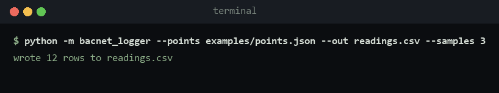

# bacnet-sim-logger

[](https://github.com/yassine2med/bacnet-sim-logger/actions/workflows/ci.yml)  

Trend data is the raw material for commissioning checks, energy reviews and fault detection, but a facility team often cannot practice on a live building. This small tool samples a list of BACnet style points on a fixed step and writes the readings to a CSV file. The default source is a deterministic simulator, so anyone can generate realistic looking trend data on a laptop. A thin adapter for a BAC0 connection is included for a real device.



## What it is for

Trend data is the raw material for commissioning checks, energy reviews and fault detection, but a facility team often cannot practice on a live building. Controls technicians, building engineers and trainees use this tool to generate realistic trend data on a laptop. They get a CSV of timestamped readings for air handler temperatures, damper position and fan status that can be used to test charts, scripts and fault rules.

## Install

```
git clone <this repo> && cd bacnet-sim-logger
python -m pip install -r requirements.txt
python -m pytest -q
```

## How to use

| I want to | Command |
|---|---|
| Log simulated points to a CSV (6 rounds by default) | `python -m bacnet_logger --points examples/points.json --out readings.csv` |
| Set the number of rounds | `--samples 3` |
| Set the seconds between rounds (default 600) | `--interval 300` |
| Set the first timestamp (default 2026-07-01T06:00) | `--start 2026-07-01T06:00` |
| Change the simulator seed (default 1) so the data differs | `--seed 7` |
| Really wait the interval between rounds | `--live` |
| Show help | `python -m bacnet_logger --help` |

The sample points in `examples/points.json` are invented (Building A, AHU-01).

Example:

```
python -m bacnet_logger --points examples/points.json --out readings.csv --samples 3
```

Output:

```
wrote 12 rows to readings.csv
```

Contents of `readings.csv`:

```
timestamp,point,value,units
2026-07-01T06:00:00,BLDGA.AHU01.SAT,60.39,degF
2026-07-01T06:00:00,BLDGA.AHU01.RAT,72.02,degF
2026-07-01T06:00:00,BLDGA.AHU01.DMPR_POS,22.42,percent
2026-07-01T06:00:00,BLDGA.AHU01.FAN_STS,False,
2026-07-01T06:10:00,BLDGA.AHU01.SAT,59.67,degF
2026-07-01T06:10:00,BLDGA.AHU01.RAT,71.32,degF
2026-07-01T06:10:00,BLDGA.AHU01.DMPR_POS,23.16,percent
2026-07-01T06:10:00,BLDGA.AHU01.FAN_STS,False,
2026-07-01T06:20:00,BLDGA.AHU01.SAT,59.66,degF
2026-07-01T06:20:00,BLDGA.AHU01.RAT,71.28,degF
2026-07-01T06:20:00,BLDGA.AHU01.DMPR_POS,24.23,percent
2026-07-01T06:20:00,BLDGA.AHU01.FAN_STS,False,
```

## How it works

- `points.py` loads a JSON list of points: name, BACnet object type, instance, units, and simulator settings (base, amplitude, noise). It rejects empty files, unknown object types and duplicate names.
- A source has one method, `read(point, when)`. `SimulatedSource` returns `base + amplitude * sin(daily cycle) + Gaussian noise`; binary points are on from 07:00 to 18:00. The seed makes runs repeatable.
- `BAC0Source` takes an object from `BAC0.lite()` and a device address. It issues `"<address> <objectType> <instance> presentValue"` for each point and converts the answer.
- `log_points` loops rounds and points, writes one CSV row per reading, and logs a failed read as an empty value so one dead point does not stop the run.

## Limits

- Simulated timestamps advance by the step without waiting, unless `--live` is set.
- The command line only uses the simulator. `BAC0Source` is used from Python code, and its tests use a stand-in object, not a live BACnet device.
- It does not discover devices, write values or handle COV subscriptions.
- BAC0 is not a dependency of this package. Install it yourself to use the adapter.

## License

MIT. See LICENSE. Yassine Emhamed, 2026.
